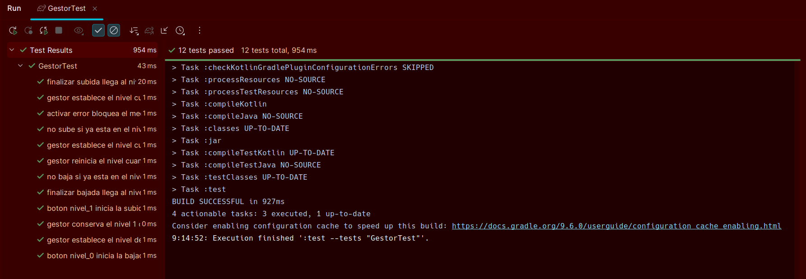

# Solución: Máquina de estados del Halo de Vigo

## 1. Objetivo

El objetivo es implementar una máquina de estados que controle
el movimiento del mecanismo entre el nivel 0 y el nivel 1.

## 2. Estados

La máquina tiene cuatro estados:

- `Idle`: el mecanismo está parado en un nivel.
- `MovingUP`: el mecanismo está subiendo.
- `MovingDOWN`: el mecanismo está bajando.
- `Error`: se ha producido un error y no puede moverse.

## 3. Variables

| Variable | Tipo | Función |
|---|---|---|
| `nivel_actual` | Int | Nivel actual del mecanismo |
| `estado_acual` | Estados | Estado actual |
| `nivel_destino` | Int | Nivel al que debe llegar |

Los valores de `nivel_actual` son:

- `0`: Avenida García Barbón.
- `1`: Plaza de Compostela.
- `2`: mecanismo en movimiento.
- `-1`: error.

## 4. Transiciones

- Desde `Idle` en el nivel 0, al pulsar `nivel_1`,
  se pasa a `MovingUP`.
- Desde `Idle` en el nivel 1, al pulsar `nivel_0`,
  se pasa a `MovingDOWN`.
- Al finalizar una subida o bajada, se llega al nivel
  de destino y se vuelve a `Idle`.
- Si se activa un error, se pasa a `Error`.
- En `Error`, los botones no permiten mover el mecanismo.

## 5. Pruebas

Los tests comprueban:

- Los valores de nivel para cada estado.
- Las transiciones de subida y bajada.
- La llegada a ambos niveles.
- El comportamiento de los botones en cada nivel.
- El bloqueo del mecanismo en caso de error.
- El tratamiento de niveles no válidos.

## 6. Funcionamiento

La función `gestor()` actualiza el nivel según el estado.
Las funciones `nivel_0()` y `nivel_1()` gestionan las
peticiones de movimiento.

La función `finalizarMovimiento()` simula la llegada
al destino y devuelve la máquina al estado `Idle`.

La función `activarError()` lleva la máquina al estado
`Error`.

## 7. Comprobación del funcionamiento de los Test

